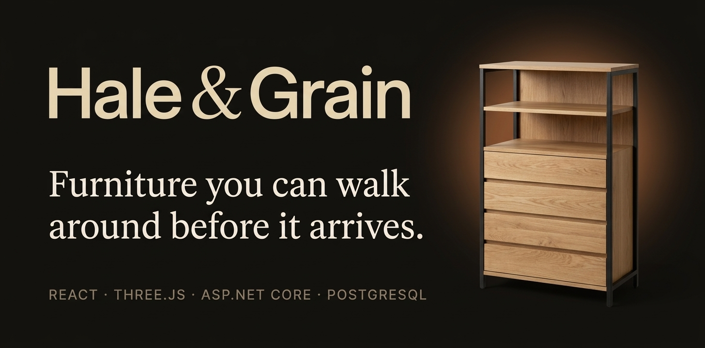

<p align="center">
  
</p>

# Hale & Grain

A furniture webshop where every product can be turned, zoomed and inspected in 3D before it goes in the cart. React and React Three Fiber on the front, ASP.NET Core and PostgreSQL behind it, with real orders, accounts and an admin area.

## What's inside

- **Storefront:** catalogue with search, filters, sorting and paging; product pages with an interactive 3D viewer whose finish swatches re-tint the model; wishlist; cart that survives reloads.
- **Checkout:** prices, stock and delivery are always recalculated on the server. Stock is reserved atomically, so two people can't buy the last item. Guests get a private link to their order.
- **Accounts:** register, sign in, password reset, saved addresses, order history, wishlist synced across devices, account deletion.
- **Admin** (`/admin`): dashboard, products (copy, prices, finishes, photos and 3D model settings with a live preview), categories, inventory, orders, customers and store settings. Every admin endpoint requires the Admin role.

| Layer | Stack |
| --- | --- |
| Frontend | React 19, TypeScript (strict), Vite, React Router, TanStack Query, Zustand, Tailwind CSS v4, Untitled UI, React Three Fiber + drei |
| Backend | ASP.NET Core (.NET 10) minimal APIs, EF Core 10, ASP.NET Core Identity (cookie auth) |
| Database | PostgreSQL 17 |
| Tests | xUnit + Testcontainers (backend), Vitest + Testing Library (frontend) |

## Quick start with Docker

The fastest way to see the whole thing running. Needs only Docker.

```sh
cp .env.example .env
# Optional: set SEED_ADMIN_EMAIL and SEED_ADMIN_PASSWORD in .env to get an admin account
docker compose up --build
```

Open <http://localhost:8080>. The `migrate` service applies database migrations and loads the demo catalogue once, then exits; `api` and `web` start after it.

To rebuild after pulling changes: `docker compose up --build -d`.

## Local development

For hot reload you run the database in Docker and the two apps directly.

### Prerequisites

- Node.js 20.19 or newer (developed on 24)
- .NET SDK 10
- Docker (for PostgreSQL and the backend tests)
- EF Core CLI, only if you change the database model: `dotnet tool install --global dotnet-ef`

### 1. Database

```sh
docker compose up -d db
```

PostgreSQL listens on `localhost:5432` with the development credentials from `docker-compose.yml`. These are local defaults only; override them in `.env`.

### 2. Backend

```sh
cd backend/FurnitureStore.Api

# Optional, once: an admin account for /admin (stored outside the repo)
dotnet user-secrets init
dotnet user-secrets set "Seed:AdminEmail" "you@example.com"
dotnet user-secrets set "Seed:AdminPassword" "ChooseALongPassw0rd"

dotnet run --launch-profile http
```

The API runs on <http://localhost:5266>. In Development it applies migrations and seeds the catalogue (and the admin, if configured) on startup.

- API reference (Scalar): <http://localhost:5266/scalar>
- Health check: <http://localhost:5266/health>

### 3. Frontend

```sh
cd frontend
npm install
npm run dev
```

Open <http://localhost:5173>. Vite proxies `/api` to the backend, so the auth cookie stays same-origin. Point the proxy elsewhere with `VITE_API_PROXY_TARGET` in `frontend/.env` (see `frontend/.env.example`).

## Configuration

Backend settings come from `appsettings*.json`, user-secrets and environment variables (`__` separates sections, e.g. `ConnectionStrings__Store`).

| Setting | Purpose | Default |
| --- | --- | --- |
| `ConnectionStrings:Store` | PostgreSQL connection string | local Docker DB in Development |
| `Seed:AdminEmail`, `Seed:AdminPassword` | Creates an Admin account on start if both are set | not set |
| `Payments:Provider` | `Development` records orders as "development, simulated" without taking money. Anything else disables checkout (503) until a real provider is wired in. | `Development` in Development |
| `Cors:AllowedOrigins` | Origins allowed to call the API cross-site | `http://localhost:5173` |
| `Frontend:BaseUrl` | Base for links in account emails | `http://localhost:5173` |
| `ForwardedHeaders:TrustAllProxies` | Trust `X-Forwarded-*` (only when the API is reachable solely through a proxy) | `false` |
| `RateLimits:AuthPerMinute` | Sign-in/registration requests per IP per minute | `20` |

Never commit real secrets; `.env` is git-ignored and `.env.example` documents every variable.

## Database and migrations

Migrations live in `backend/FurnitureStore.Api/Data/Migrations`.

```sh
cd backend/FurnitureStore.Api

# Apply migrations and load seed data, then exit (what the Docker migrate service runs)
dotnet run -- --seed

# After changing the model
dotnet ef migrations add DescribeTheChange -o Data/Migrations
dotnet ef migrations has-pending-model-changes
```

Seed data is deterministic: five products with fixed IDs, finishes, photos and 3D models. Seeding only runs into an empty catalogue, so it never overwrites edits. To start over locally: `docker compose down -v && docker compose up -d db`.

## Tests

```sh
# Backend: unit tests plus API tests against a throwaway PostgreSQL container (Docker must be running)
cd backend && dotnet test

# Frontend
cd frontend
npm test            # Vitest
npm run typecheck   # tsc
npm run lint        # oxlint
npm run build       # production build
```

The backend suite covers pricing rules, catalogue queries, order creation, concurrent checkouts that must not oversell, order access control, authentication, customer data isolation and admin authorisation.

## Project layout

```text
backend/
  FurnitureStore.Api/
    Domain/            entities (Product, Variant, Order, ...)
    Data/              DbContext, EF configurations, migrations, seed data
    Features/          Catalog, Orders, Account, Admin: endpoints, DTOs and services per feature
  FurnitureStore.Tests/
frontend/
  public/models/       .glb furniture models
  public/images/       product renders and the hero cutout
  src/
    Routes/            all routes (routes.tsx), path helpers, auth and admin guards
    layouts/           Store, Auth, Profile and Admin shells
    pages/             one page per route; pages with their own components get a folder
    features/          catalog, cart, checkout, viewer (3D), auth, account, admin, wishlist
    components/        shared UI; base/ holds Untitled UI, reactbits/ holds adapted React Bits
scripts/assets/        Blender scripts that produced the models and renders
assets/                banner and original logo artwork
```

## 3D models

Products store a model URL plus per-model settings (scale, turn, which materials a finish tints). The `.glb` files are served as static assets; the database only holds references. The viewer loads lazily on product pages, falls back to photos when WebGL is unavailable or a file fails to load, and respects reduced-motion settings.

The five models are CC0 assets from [Poly Haven](https://polyhaven.com), converted and downsized with the Blender scripts in `scripts/assets/`. See [ASSETS.md](ASSETS.md) for sources and how to regenerate them.

## Payments and email

There is no real payment provider yet. With `Payments:Provider=Development` the checkout is clearly labelled as a development checkout and orders are recorded as "development, simulated", never as paid. To go live, implement `IPaymentProvider` (`backend/FurnitureStore.Api/Features/Orders/Payments.cs`) for your provider.

Account emails (confirmation, password reset) are written to the API log by `LoggingEmailSender`. Swap in a real `IEmailSender<AppUser>` before production. Password reset only works for confirmed email addresses, so locally: register, copy the confirmation link from the log, then request a reset.

## Before production

- Wire up a real payment provider and email sender.
- Serve over HTTPS, set `ASPNETCORE_ENVIRONMENT=Production`, and use a managed PostgreSQL with its own credentials.
- Run migrations as a deploy step (`dotnet run -- --seed` or a migration bundle) rather than on startup.
- Set real values for `Cors:AllowedOrigins` and `Frontend:BaseUrl`.

## Not done yet

- Dutch/English translation
- About and Contact pages (linked from the footer)

## Licence and credits

3D models: Poly Haven, CC0. UI components: Untitled UI and React Bits (MIT), adapted where noted in the source.
